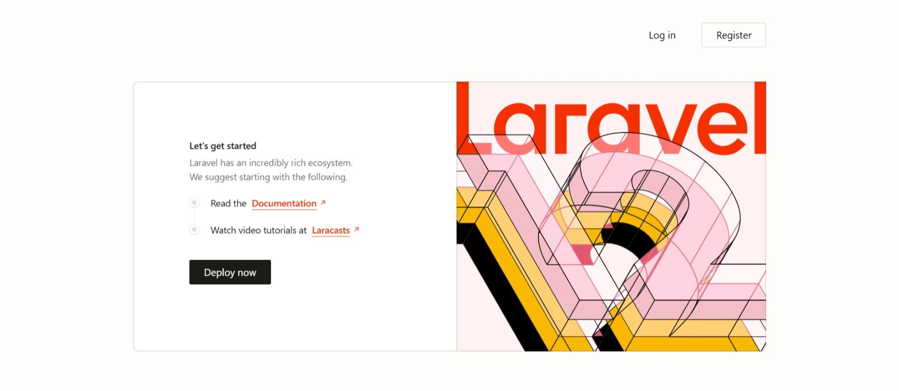
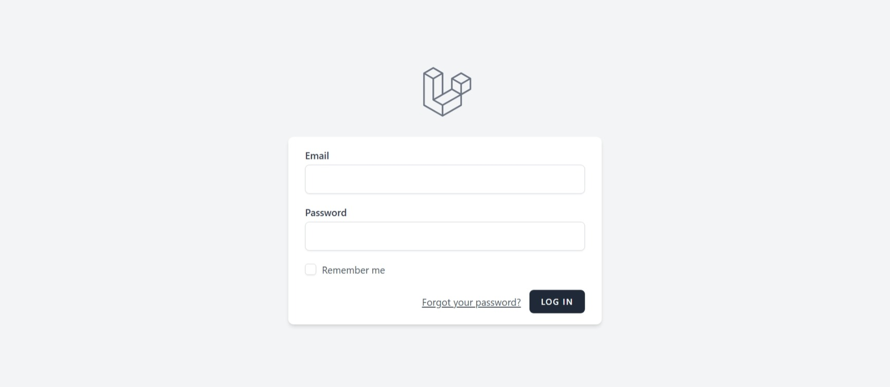
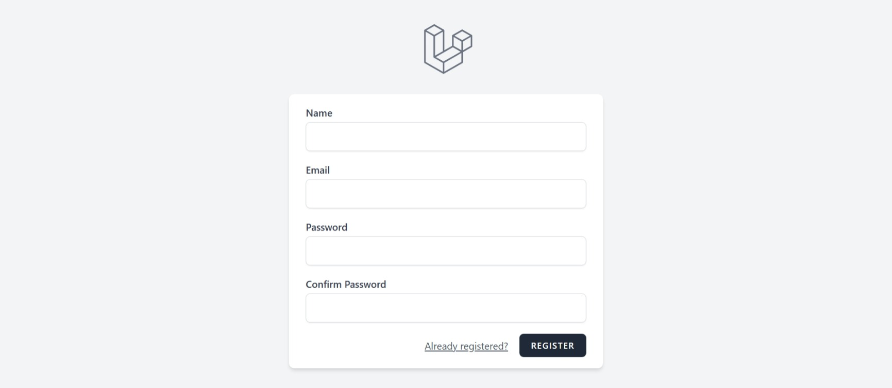
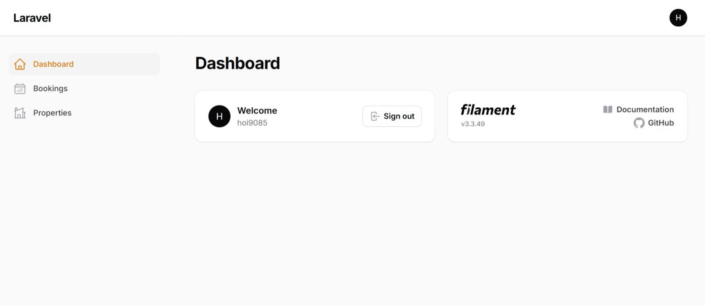
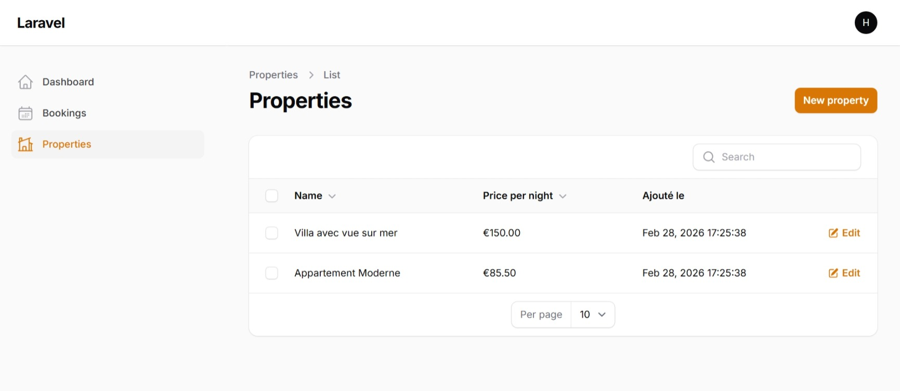
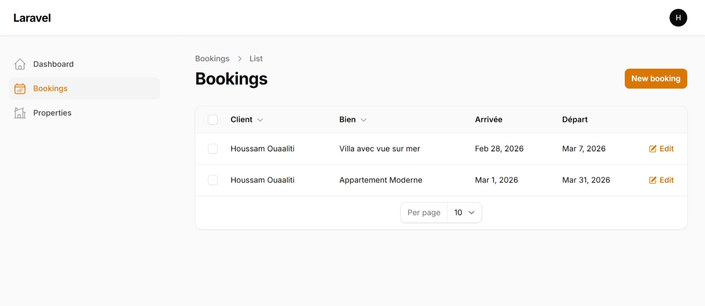
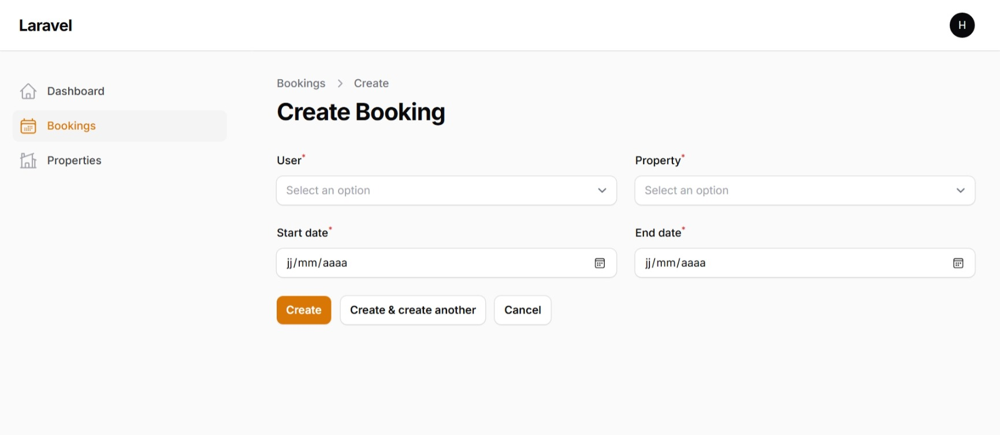

# Property Booking Platform

A Laravel web application to manage rental **properties** and their **bookings**, with user authentication and an administration interface.

## Features

- User registration, login and profile management (Laravel Breeze)
- Authenticated property listing
- Admin interface: dashboard, property list, bookings table and booking creation form
- Relational data model: `users`, `properties`, `bookings` (Eloquent models and migrations)

## Tech stack

| Layer | Technologies |
|-------|--------------|
| Backend | PHP 8.2, Laravel 12, Eloquent ORM, Laravel Breeze |
| Frontend | Blade templates, Tailwind CSS 3, Vite |

## Screenshots

| Landing page | Login |
|---|---|
|  |  |

| Registration | Admin dashboard |
|---|---|
|  |  |

| Properties list | Bookings management |
|---|---|
|  |  |

| Create a booking |
|---|
|  |

## Getting started

Requirements: PHP 8.2+, Composer, Node.js, a database supported by Laravel (SQLite by default).

```bash
composer install
cp .env.example .env
php artisan key:generate
php artisan migrate
npm install
npm run dev
php artisan serve
```

Then open <http://localhost:8000>.

## Tests

```bash
php artisan test
```

## Skills demonstrated

PHP · Laravel · MVC architecture · Eloquent ORM and migrations · authentication · Blade · Tailwind CSS · Vite
